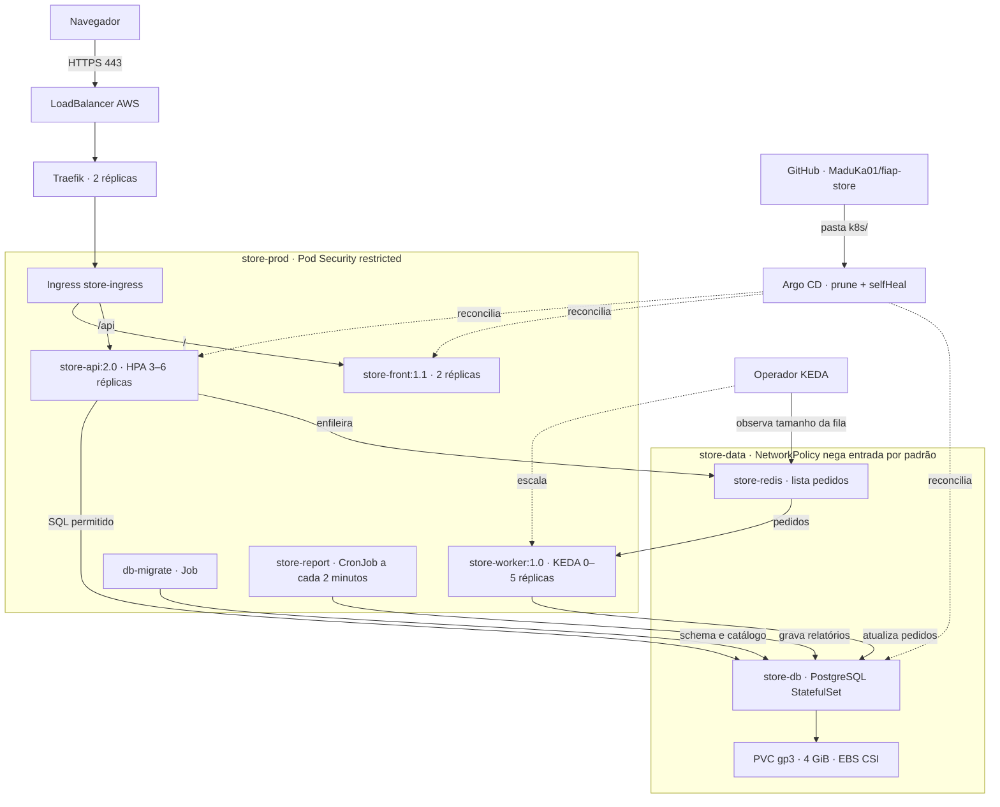

# Arquitetura implantada — FIAP Store

Referência para o documento com prints e a gravação. Estado desta etapa: EKS 1.35, quatro nós em três zonas, API 2.0 e front 1.1; worker em zero com fila vazia. Recursos de aplicação são reconciliados pelo Argo CD a partir de `k8s/`.

## Partes para explicar com os prints

- **Infraestrutura:** quatro t3.medium, em us-east-1a (dois nós), us-east-1b e us-east-1c. Sem NAT Gateway; LabRole existente para cluster e nós; sem OIDC/IRSA.
- **Entrada:** balanceador AWS e Traefik; Ingress padrão com `/api` e `/`. TLS autoassinado com SAN do hostname real do balanceador. O certificado atende o laboratório e exige aceite manual no navegador.
- **Disponibilidade da API:** HPA mínimo três, distribuição por zonas, probes, PDB mínimo dois, rolling update maxUnavailable zero e duas revisões após o rollout real 1.0 → 2.0 por commit.
- **Dados:** banco único com volume EBS em uma zona. O volume preserva dados após recriação do Pod; a arquitetura não fornece failover do banco entre zonas. Redis usa armazenamento efêmero e a fila não resiste à perda do Pod.
- **Segurança:** front não alcança banco; API, worker e jobs têm acessos definidos por label e namespace. ServiceAccount da API só recebe get nodes. Front/worker não montam token. Grupo fiap:devs lê Pods/logs, sem exec, Secrets ou exclusão.
- **GitOps:** estado desejado versionado no GitHub; Argo CD com prune e selfHeal. Réplicas controladas por HPA/KEDA ficam fora da reconciliação de replicas do Argo. Secrets são criados diretamente no cluster, fora do Git.
- **Observabilidade e rotinas:** Metrics Server fornece CPU ao HPA; DaemonSet do grupo cobre os quatro nós. Migração é Job Sync do Argo mantido após sucesso; CronJob já teve execução agendada bem-sucedida.
- **Imagens:** imagens da aplicação no ECR, linux/amd64 e usuários sem root. Front 1.1 corrige os achados CRITICAL da imagem 1.0; API/worker ainda têm achados HIGH documentados nos relatórios Trivy.

## Capturas pendentes

Produzir os prints reais do console AWS, da loja, do painel, do Argo CD e dos testes de escalonamento e segurança. Este diagrama descreve os recursos; ele não substitui as capturas nem as demonstrações de comportamento. Veja `EVIDENCIAS-E-VIDEO.md` para a lista completa.
